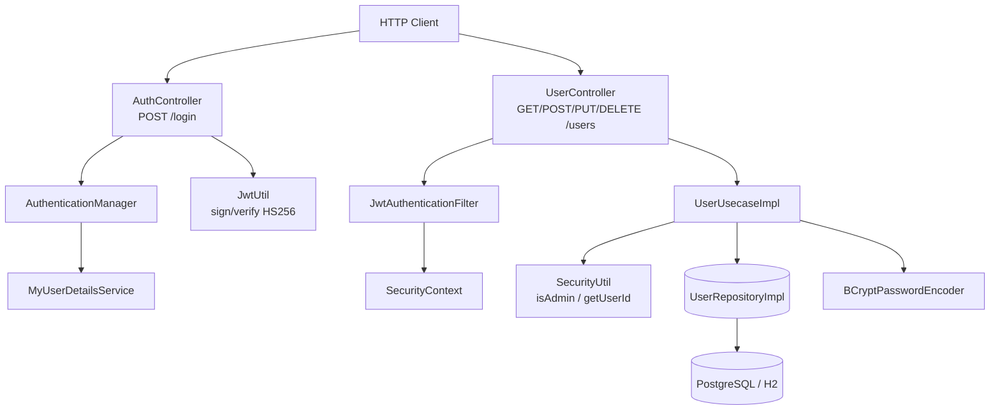
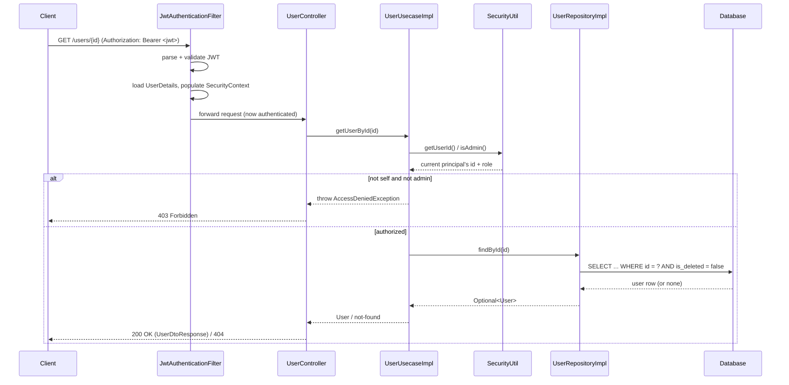

# WeFood User Service

## Purpose

A user-management backend for a multi-restaurant food ordering platform
("WeFood"): registration, authentication, profile lookup/update, and
soft-deletion, with three roles (`ADMIN`, `RESTAURANT_OWNER`, `CUSTOMER`)
and role/ownership-aware access control. Built as a Hexagonal/Clean
Architecture Spring Boot service — business rules live in a
framework-independent core, with REST, persistence and security wired in
as adapters around it.

- Self-registration (anyone can create a `CUSTOMER` account; only an
  `ADMIN` can create `RESTAURANT_OWNER`/`ADMIN` accounts).
- JWT-based login; stateless sessions.
- Per-user access control: a user can read/update/delete their own record;
  an admin can act on any user; role changes on update require admin.
- Paginated user listing (admin-only).
- Soft deletion (`is_deleted` flag + a Hibernate filter), so deleted users
  disappear from queries without losing the row.

## Technologies

- **Java 21** / **Spring Boot 3.4**
- **Spring Web** — REST controllers (`AuthController`, `UserController`)
- **Spring Security** + **jjwt** — stateless JWT authentication, method
  security (`@PreAuthorize`), BCrypt password hashing
- **Spring Data JPA** / **Hibernate** — persistence, with a `deletedFilter`
  Hibernate filter for soft deletion
- **PostgreSQL** (via `docker-compose-postgres.yaml`) or **H2** in-memory
  (via `docker-compose-h2.yaml`) — swappable via Spring profiles
- Manual mappers (`UserMapper`, `AddressMapper`) — domain ↔ DTO ↔ JPA
  entity translation at each architectural boundary
- **springdoc-openapi** — Swagger UI + OpenAPI docs
- **JUnit 5** + **Mockito** + **Testcontainers** — unit and integration tests
- **Docker** / **Docker Compose** — containerized app + database
- **Postman** — a ready-made collection (`postman/WeFood.json`) covering
  every endpoint as both admin and regular user

## Architecture



Dependencies point inward: `UserController`/`AuthController` (inbound
adapters) depend on `UserUseCase`/`JwtUtil`; `UserUsecaseImpl` (the
application core) depends only on the `UserRepository` and
`PasswordEncoder` *interfaces*; `UserRepositoryImpl` and
`BcryptPasswordEncoderEncoderAdapter` (outbound adapters) implement those
interfaces against JPA/Hibernate and Spring Security's BCrypt,
respectively. The domain (`User`, `Address`, `Role`) has no framework
imports at all.

## Execution flow



1. Every request to a protected endpoint passes through
   `JwtAuthenticationFilter`, which parses the `Authorization` header, and
   — if the token is present and valid — populates Spring Security's
   `SecurityContext` with the authenticated principal and role before the
   request reaches the controller.
2. Spring Security's `authorizeHttpRequests` config requires authentication
   for every endpoint except `POST /login`, `POST /users`
   (self-registration) and the docs/console paths — so a missing or
   invalid token is rejected with 401 before any controller code runs.
3. The controller delegates to `UserUsecaseImpl`, which asks `SecurityUtil`
   for the current principal's id and role and enforces the
   ownership/role rule for that specific operation (e.g. "same user or
   admin") — a second, defense-in-depth layer on top of the HTTP-level
   check.
4. `UserRepositoryImpl` applies a Hibernate `deletedFilter` on every query
   so soft-deleted users are invisible to normal reads, then maps the JPA
   entity back to the domain `User` via `UserMapper`.
5. Passwords are only ever handled through the `PasswordEncoder` interface
   (BCrypt underneath); plaintext passwords never reach persistence.

## Running it

```sh
docker compose -f docker-compose-h2.yaml up -d --build     # in-memory H2, zero setup
# or
docker compose -f docker-compose-postgres.yaml up -d --build  # PostgreSQL
```

Override the committed local-dev defaults for anything beyond local
development — `JWT_SECRET` and `ADMIN_PASSWORD` are read from the
environment if set (`JWT_SECRET=... ADMIN_PASSWORD=... docker compose ... up`);
both compose files pass them through to the container.

- App: `http://localhost:8080`
- Swagger UI: `http://localhost:8080/swagger-ui/index.html`
- OpenAPI docs: `http://localhost:8080/v3/api-docs`
- Postman collection: `postman/WeFood.json`
- Default admin: username `admin`, password `Password1@` (or
  `ADMIN_PASSWORD` if set)

## Testing

```sh
./gradlew test
```

`UserControllerTest` and `JwtAuthenticationFilterTest` are plain Mockito
unit tests (no Spring context or database) covering the pagination
default in `UserController` and `JwtAuthenticationFilter`'s handling of
malformed/missing bearer tokens. `WefoodApplicationTests` is the existing
Spring context smoke test.

## Metrics

Measured against the H2-profile container (`docker-compose-h2.yaml`) with
[`hey`](https://github.com/rakyll/hey), Apple M1, to compare two request
types that stress different layers of the stack:

```sh
hey -z 10s -c 10 -m POST -H "Content-Type: application/json" \
  -d '{"username":"admin","password":"Password1@"}' http://localhost:8080/login
hey -z 10s -c 20 -H "Authorization: Bearer <token>" "http://localhost:8080/users/<id>"
```

| Endpoint | req/sec | avg latency | p50 | p90 | p99 |
|---|---:|---:|---:|---:|---:|
| `POST /login` (BCrypt verify, c=10) | ~44 | 225 ms | 229 ms | 261 ms | 298 ms |
| `GET /users/{id}` (JWT verify + DB read, c=20) | ~1,278 | 15.6 ms | 13.7 ms | 28.0 ms | 45.3 ms |

The ~29x latency gap between the two is almost entirely BCrypt: it's
deliberately slow (adaptive work-factor hashing, the default Spring
`BCryptPasswordEncoder` strength), by design, to make brute-forcing stolen
password hashes expensive — the same property that makes login the
service's throughput ceiling under concurrent load. `GET /users/{id}`, by
contrast, only pays for JWT signature verification (HMAC-SHA256, cheap)
plus a single indexed-PK read, so it's nearly two orders of magnitude
faster. This is the expected, correct shape for an auth-gated CRUD
service: the deliberately expensive operation is the one an attacker would
want to brute-force, not the one legitimate traffic calls on every
request.

### Tradeoff: HTTP-level authorization vs. per-use-case ownership checks

Two layers enforce access control here, deliberately:

| Layer | What it enforces | What it can't do alone |
|---|---|---|
| Spring Security `authorizeHttpRequests` (HTTP layer) | "Is there a valid JWT at all?" — a blanket authentication requirement per path, independent of business rules | Can't express "only the owner or an admin" — that's a runtime decision based on *which* user and *which* resource |
| `UserUsecaseImpl` + `SecurityUtil` (application layer) | Per-operation rules: same-user-or-admin for get/update/delete, admin-only for list, role-restricted for create | If this were the *only* layer, any endpoint added later without an explicit check defaults to open — there's no fallback deny |

Relying on only one of these is the common failure mode: HTTP-only misses
per-resource ownership; usecase-only means a forgotten check on a new
endpoint is silently wide open rather than silently closed. Both layers
being present means the failure mode for a missing check becomes "401 by
default" rather than "no auth at all."

### Tradeoff: soft delete vs. hard delete

`UserRepositoryImpl.delete` sets an `is_deleted` flag rather than removing
the row, and every read path applies a Hibernate `@Filter` to exclude
soft-deleted rows:

| Approach | Pros | Cons |
|---|---|---|
| Soft delete (used here) | Deleted users' data survives for auditing/recovery; foreign keys from orders/reviews elsewhere in the platform don't dangle | Every query needs the filter enabled or it leaks deleted rows; unique constraints (e.g. username/email) still see the "deleted" row, so a deleted username can't be immediately reused without extra handling |
| Hard delete | Simpler queries, no filter to forget, unique constraints behave intuitively | Deleting a user leaves order/review history pointing at nothing (or needs explicit cascade/anonymization everywhere else in the platform); audit history is lost |

For a multi-restaurant platform where other services (orders, reviews)
will eventually reference `User` by id, soft delete is the right default
even though it pushes a small amount of query discipline onto every
repository method.

## Endpoints

- Postman collection: `postman/WeFood.json`
- Swagger UI: `http://localhost:8080/swagger-ui/index.html`
- OpenAPI docs: `http://localhost:8080/v3/api-docs`

| Method | Path | Auth | Notes |
|---|---|---|---|
| `POST` | `/login` | none | Returns `{token, username, userId, expiresAt}` |
| `POST` | `/users` | none | Anyone can create `CUSTOMER`; `ADMIN` can create any role |
| `GET` | `/users?page=&size=` | JWT, `ADMIN` only | Paginated list, zero-indexed `page` (default 0), `size` default 10 |
| `GET` | `/users/{id}` | JWT | Self or `ADMIN` |
| `PUT` | `/users` | JWT | Self (not own role) or `ADMIN` (any field) |
| `DELETE` | `/users/{id}` | JWT | Self or `ADMIN`; soft delete |

### Request/response shapes

```json
// UserDtoRequest
{
  "id": "uuid (omit on create)",
  "name": "string", "email": "string", "username": "string",
  "password": "string", "role": "ADMIN|RESTAURANT_OWNER|CUSTOMER",
  "address": { "street": "", "number": "", "complement": "", "city": "", "state": "" }
}

// UserDtoResponse
{
  "id": "uuid", "name": "", "email": "", "username": "", "role": "",
  "createdAt": "ISO-8601", "modifiedAt": "ISO-8601",
  "address": { "id": "uuid", "street": "", "number": "", "complement": "", "city": "", "state": "" }
}

// LoginRequestDTO / LoginResponse
{ "username": "", "password": "" }
{ "token": "", "username": "", "userId": "", "expiresAt": "" }
```

## Project structure

```
src/main/java/br/com/fiap/wefood/
├── adapters/
│   ├── inbound/controller/      AuthController, UserController (REST)
│   └── outbound/
│       ├── password/            PasswordEncoder interface + BCrypt adapter
│       └── repositories/        JpaUserRepository, UserRepositoryImpl, JPA entities
├── application/usecases/        UserUseCase / UserUsecaseImpl - the business rules
├── domain/user/                 User, Address, Role - no framework imports
├── dto/                         Request/response DTOs
├── infrastructure/
│   ├── config/                  SwaggerConfig, AdminUserInitializer
│   └── exceptions/              GlobalExceptionHandler + domain exceptions
├── security/                    JWT filter/util, SecurityConfig, SecurityUtil
└── utils/mapper/                Domain <-> DTO <-> entity mappers
```
